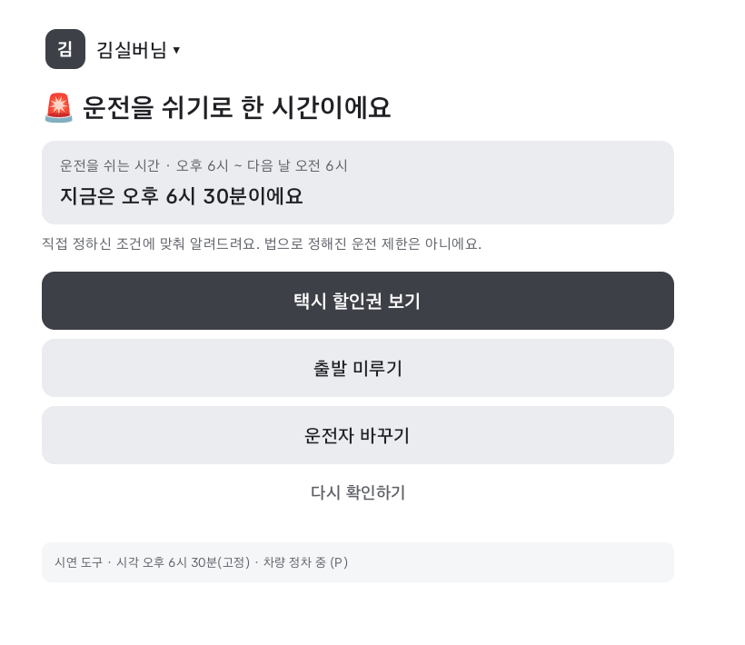
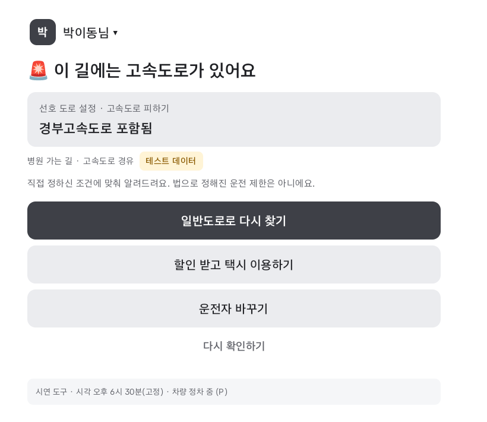
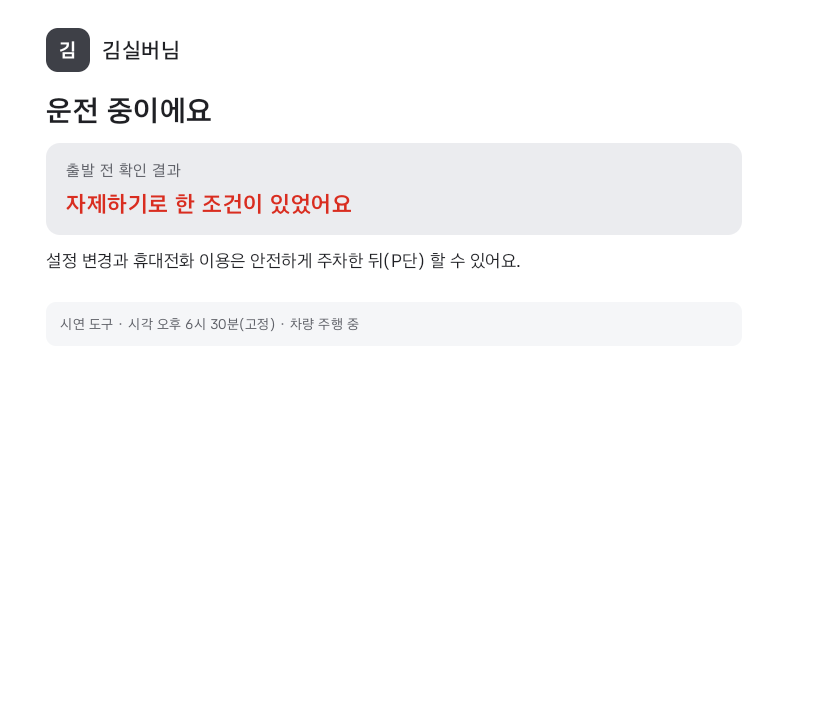
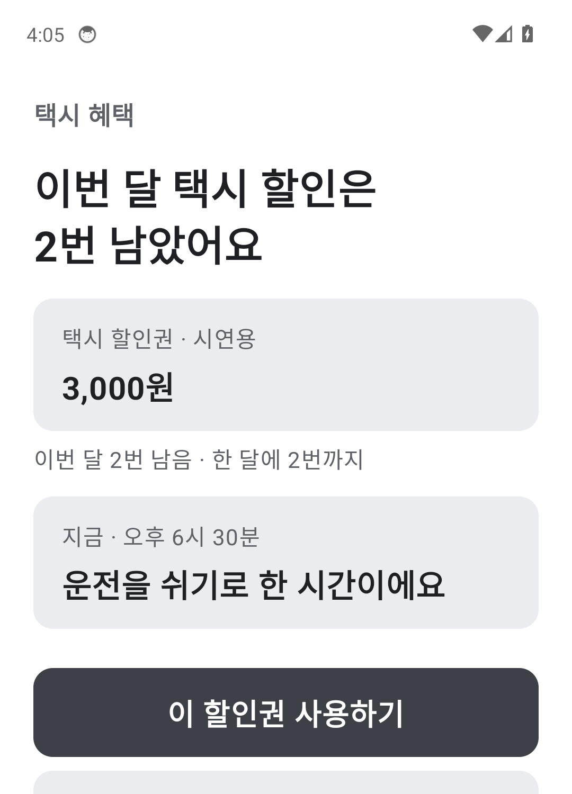
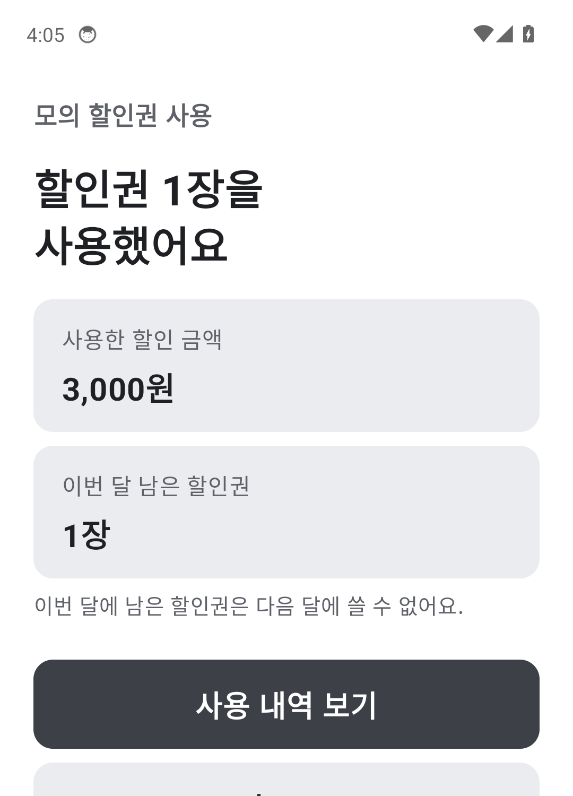

# 실버패스 (Silver Pass)

> 고령 운전자의 안전한 운전과 자유로운 이동을 위해

현대자동차·기아 **차량용 앱 공모전(Pleos Playground)** 출품용 프로토타입.
고령 운전자가 직접 정한 운전 자제 조건(운전을 쉬는 시간, 고속도로 피하기)을 **차에서 출발 전에 확인**해 주고,
해당하면 출발 미루기·일반도로 경로·**택시 할인(모의)** 같은 다른 이동 방법을 안내한다.
차량 앱(Pleos Connect)과 휴대전화 앱으로 이루어진다.

| 시나리오 A · 저녁 운전 대신 택시 | 시나리오 B · 고속도로를 피해 경로 변경 |
|---|---|
|  |  |

| 주행 중(기어 D) | 휴대전화 · 택시 할인권 | 휴대전화 · 사용 완료 |
|---|---|---|
|  |  |  |

## 무엇을 하나
**차량 앱**
1. 정차(P단) 상태에서 운전자 선택 — 기어 신호는 Vehicle SDK `Gear`로 받는다. 주행 중엔 선택·조작이 막히고 요약만 보인다.
2. 출발 전 조건 확인 — 지금 시각(또는 출발 예정 시각)과 경로를 운전자 조건과 비교한다.
3. 해당하면 경고와 다음 행동: 택시 할인권 보기 / 출발 미루기(시각을 골라 다시 확인) / 일반도로로 다시 찾기 / 운전자 바꾸기.
4. 경로 정보가 없으면 "문제없음"이 아니라 "확인할 수 없어요"로 안내한다.

**휴대전화 앱**
1. 시연 계정으로 시작, 운전 조건 확인·수정(운전을 쉬는 시간, 고속도로 피하기).
2. 모의 택시 할인권: 회당 3,000원·월 2회·이월 없음, 시연용 이용 완료 입력, 중복 차감 방지, 사용 내역.

**함께 되는 것(2차 범위 일부 포함)**
- 동기화 서버(`server/`, 전용 서버 + Docker Compose, Cloudflare 뒤): 간편 가입, 차량 화면 6자리 연결번호로 휴대전화 연결, 운전 조건·할인권·주행 계획 동기화
- 실제 내비 경로(NaviHelper): 목적지·경로가 바뀌면 자동으로 고속국도 포함 여부를 다시 판정, '일반도로로 다시 찾기'는 무료도로 우선 재탐색
- 주행 계획(휴대전화): 출발 일시·주소를 넣으면 네이버 길찾기 옵션별 시간·경로 그림·조건 충돌을 보여 주고, 저장하면 차에서 [내비에 적용]

기능별 상태는 [docs/SPEC_STATUS.md](docs/SPEC_STATUS.md).

## 실행 환경·APK
| 항목 | 값 |
|---|---|
| 개발·검증한 에뮬레이터 | **Pleos Connect v2.1.0** (Android 14 / API 34, x86_64, AVD 기기 `Pleos_Connect_v2_0`) |
| 차량 화면 규격 | **2560×1440** (가로, 160dpi · 1dp = 1px). 앱 영역은 x≈860~2560 |
| 휴대전화 검증 | Android 14 (API 34) Pixel 6 에뮬레이터, 1080×2400 |
| APK | [`apk/`](apk/) 폴더 (release 빌드)<br>· `실버포니_실버패스-차량_release.apk` — 차량 앱 `com.silverpass.vehicle` (Pleos Connect 에뮬레이터)<br>· `실버포니_실버패스-휴대전화_release.apk` — 휴대전화 앱 `com.silverpass.mobile` (arm64-v8a·x86_64) |
| 동기화 서버 | `https://silverpass-server.kodori.dev` (앱에 기본값으로 들어 있음) |

차량 앱은 Pleos 에뮬레이터의 사용자 10에 설치해 실행한다(`adb install` 후 `am start --user 10 -n com.silverpass.vehicle/.VehicleActivity`).

release 빌드: `./gradlew assembleRelease`. 서명 키는 저장소 밖 `secrets/release-signing.properties`(템플릿 `secrets/release-signing.properties.example`)에서 읽고, 없으면 debug 키로 서명된다.

## 빠른 시작
```bash
tools/setup-linux.sh               # 최초 1회 개발 환경 (Linux x86_64). macOS/Windows는 docs/SETUP.md
source tools/env.sh
./gradlew :core:testDebugUnitTest assembleDebug

tools/start-emulator.sh && tools/vconsole.sh keepalive
adb -s $PLEOS_SERIAL install -r vehicle/build/outputs/apk/debug/vehicle-debug.apk
adb -s $PLEOS_SERIAL shell am start --user 10 -n com.silverpass.vehicle/.VehicleActivity
tools/vconsole.sh gear Drive       # 주행 중 화면 확인, 되돌리기: gear Park

tools/start-phone.sh
adb -s $PHONE_SERIAL install -r mobile/build/outputs/apk/debug/mobile-debug.apk
adb -s $PHONE_SERIAL shell am start -n com.silverpass.mobile/.MobileActivity
```
두 앱 모두 화면 맨 아래 "시연 도구"에서 기준 시각(기본 오후 6시 30분), 테스트 경로, 실패 상황을 바꿀 수 있다.

## 문서
- [docs/SPEC_STATUS.md](docs/SPEC_STATUS.md) — 기능 명세 ID별 구현 상태
- [docs/e2e/report-2026-11-11.html](docs/e2e/report-2026-11-11.html) — E2E 결과 보고서(41단계·검사 231개 전부 통과, 스크린샷 포함, 내려받아 브라우저로 열기). 다시 만들기: `tools/e2e/run.py`
- [server/README.md](server/README.md), [server/SECURITY.md](server/SECURITY.md) — 동기화 서버 API·보안 점검
- [docs/CONTEST.md](docs/CONTEST.md) — 공모전 일정·심사 기준
- [docs/SETUP.md](docs/SETUP.md) — 개발 환경 설치 상세
- [docs/EMULATOR_NOTES.md](docs/EMULATOR_NOTES.md) — 에뮬레이터에서 확인한 동작과 우회

## 라이선스 주의
Pleos Connect SDK·에뮬레이터는 42dot SDK License Agreement를 따른다(재배포 금지, Pleos 호환 앱 개발 용도로만 사용).
이 저장소에는 SDK 바이너리, 시스템 이미지, 42dot 샘플 코드를 넣지 않는다. 의존성은 Gradle이 Pleos Maven에서 받는다.
